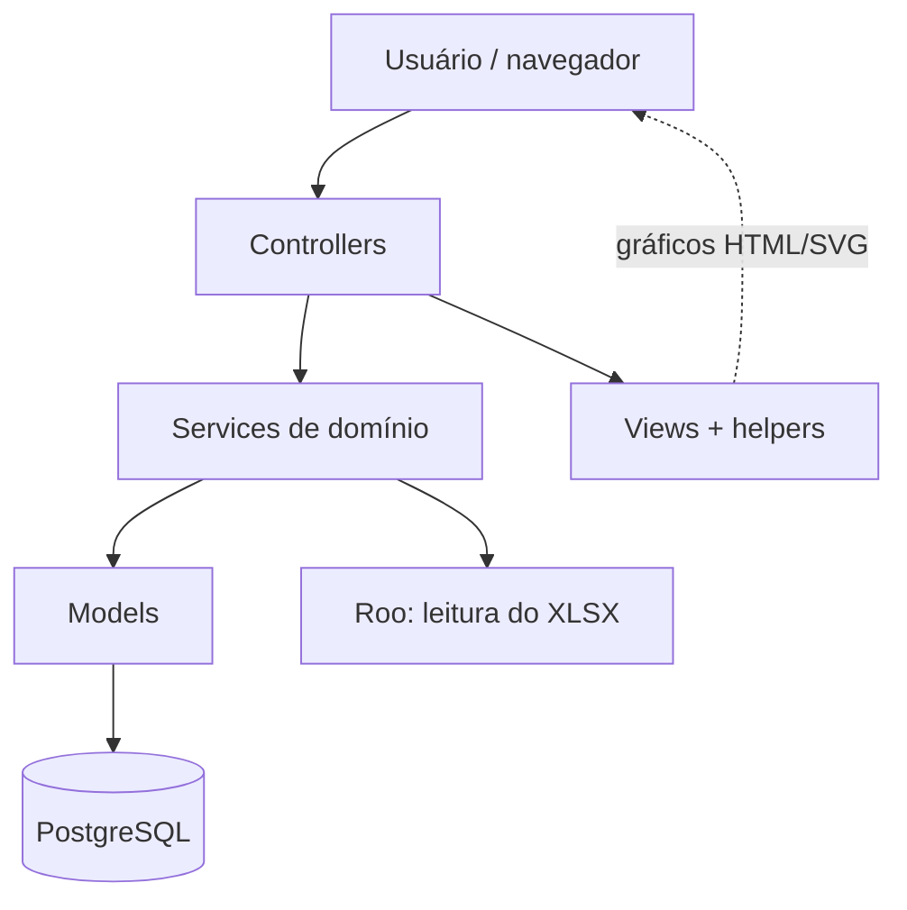
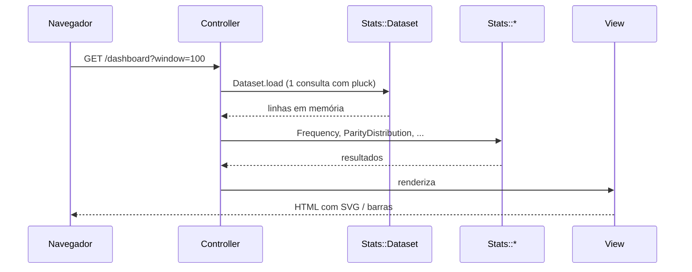

## [← Voltar ao README](../README.md)

---

# Arquitetura

O MegaStats usa a arquitetura **MVC** do Ruby on Rails, complementada por **services de domínio** que concentram as regras de negócio e os cálculos, mantendo controllers e views simples.

## Visão em camadas

| Camada              | Responsabilidade                                                                                   |
| ------------------- | -------------------------------------------------------------------------------------------------- |
| **Models**          | Representação dos dados, associações, validações e regras de persistência                          |
| **Controllers**     | Receber a requisição HTTP, validar parâmetros, chamar services e escolher a resposta (HTML ou CSV) |
| **Services**        | Processos de negócio, cálculos estatísticos, importação, validação e exportação                    |
| **Views / helpers** | Apresentação: tabelas, mapas de calor, barras e gráficos de linha em SVG                           |

## Componentes

### Models (`app/models`)

| Componente    | Responsabilidade                                                                                                                              |
| ------------- | --------------------------------------------------------------------------------------------------------------------------------------------- |
| `Draw`        | Um concurso da Mega-Sena. A URL usa o número do concurso (`/draws/3080`). Oferece `numbers`, `numbers_sum`, `even_count`, `band_counts`       |
| `ImportBatch` | Registro de auditoria de uma importação (arquivo, hash, status, contadores, erros e relatório de validação)                                   |
| `DrawFilter`  | Objeto simples que interpreta e valida filtros (período, dezena, ordem, paginação), monta o escopo e preserva o filtro em links e exportações |

### Importação e auditoria (`app/services/mega_sena`)

| Componente                      | Responsabilidade                                                                      |
| ------------------------------- | ------------------------------------------------------------------------------------- |
| `MegaSena::XlsxImporter`        | Importa e valida a planilha de forma incremental. Veja [importacao.md](importacao.md) |
| `MegaSena::HistoricalValidator` | Audita a integridade de todo o histórico armazenado                                   |

### Estatística (`app/services/mega_sena/stats`)

| Componente              | Responsabilidade                                                                                                         |
| ----------------------- | ------------------------------------------------------------------------------------------------------------------------ |
| `Dataset`               | Carrega o histórico **uma única vez** (`pluck`) e permite fatiar por janela (últimos 50/100/500) ou por escopo (período) |
| `Frequency`             | Frequência absoluta, relativa e percentual; rankings; atraso e intervalo médio                                           |
| `PeriodComparison`      | Compara a frequência de um período com o histórico completo                                                              |
| `ParityDistribution`    | Distribuição de pares e ímpares                                                                                          |
| `SumDistribution`       | Distribuição, média e mediana da soma das dezenas                                                                        |
| `Evolution`             | Evolução da frequência de uma dezena por blocos de concursos                                                             |
| `CombinationFrequency`  | Pares e ternos mais frequentes                                                                                           |
| `ConsecutiveRepetition` | Dezenas repetidas do concurso anterior                                                                                   |
| `ConsecutiveNumbers`    | Dezenas consecutivas no mesmo concurso (ex.: 12 e 13)                                                                    |
| `RangeDistribution`     | Distribuição por faixas numéricas e perfis de faixas                                                                     |
| `Combinatorics`         | Matemática exata: binomial e probabilidades esperadas por acaso                                                          |

### Relatórios e exportação

| Componente                        | Responsabilidade                                                                                 |
| --------------------------------- | ------------------------------------------------------------------------------------------------ |
| `MegaSena::Reports::PeriodReport` | Reúne todas as análises e o resumo financeiro de um conjunto de concursos; memoriza cada cálculo |
| `MegaSena::Exports::CsvBuilder`   | Gera CSV pronto para o Excel em português (`;`, vírgula decimal, BOM UTF-8)                      |

### Controllers

| Controller                | Telas                                      |
| ------------------------- | ------------------------------------------ |
| `ImportBatchesController` | Listagem, upload e detalhe das importações |
| `DashboardController`     | Dashboard estatístico                      |
| `CombinationsController`  | Pares, ternos e repetição                  |
| `DistributionsController` | Consecutivas e faixas                      |
| `DrawsController`         | Lista, detalhe e CSV de concursos          |
| `ReportsController`       | Relatório por período e CSV                |

Os controllers de análise compartilham a mesma lista de períodos (`DashboardController::WINDOWS`: últimos 50, 100, 500 ou todo o histórico).

## Fluxo de uma análise

O carregamento único em memória é intencional: com alguns milhares de concursos, os cálculos levam milissegundos e evitam consultas repetidas.

## Princípios de projeto

- **Separação de responsabilidades:** regras de negócio e cálculos ficam em services, não em controllers ou views.
- **Validação em múltiplas camadas:** a planilha é validada no importador, o `Draw` valida no model e o banco garante a integridade com `CHECK constraints`, índice único e chave estrangeira.
- **Integridade do histórico:** nenhum concurso gravado é alterado silenciosamente.
- **Transações** em operações de gravação.
- **Valores esperados exatos:** as comparações com o acaso usam combinatória exata, não simulação.
- **Sem dependências desnecessárias:** gráficos em HTML/CSS/SVG renderizados no servidor.
- **Testes automatizados** para models, services e controllers.

---

## [← Voltar ao README](../README.md)

---
