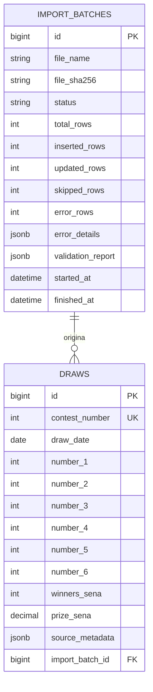

## [← Voltar ao README](../README.md)

---

# Banco de dados

O banco é **PostgreSQL**. A integridade é garantida pelo próprio banco por meio de `CHECK constraints`, índice único e chave estrangeira, além das validações do Rails.

## Diagrama



## Tabela `draws`

Um registro por concurso.

| Coluna                     | Tipo                      | Descrição                                        |
| -------------------------- | ------------------------- | ------------------------------------------------ |
| `contest_number`           | integer, **único**, `> 0` | Número do concurso                               |
| `draw_date`                | date                      | Data do sorteio                                  |
| `number_1` … `number_6`    | integer, `1..60`          | As seis dezenas, na ordem da planilha            |
| `winners_sena`             | integer                   | Ganhadores com 6 acertos                         |
| `prize_sena`               | decimal(15,2)             | Rateio (prêmio por ganhador) da Sena             |
| `winners_quina`            | integer                   | Ganhadores com 5 acertos                         |
| `prize_quina`              | decimal(15,2)             | Rateio da Quina                                  |
| `winners_quadra`           | integer                   | Ganhadores com 4 acertos                         |
| `prize_quadra`             | decimal(15,2)             | Rateio da Quadra                                 |
| `city_uf`                  | string                    | Cidade / UF dos ganhadores da Sena               |
| `accumulated_sena`         | decimal(15,2)             | Valor acumulado para a Sena                      |
| `total_revenue`            | decimal(15,2)             | Arrecadação total                                |
| `estimated_prize`          | decimal(15,2)             | Estimativa do próximo prêmio                     |
| `special_draw_accumulated` | decimal(15,2)             | Acumulado do sorteio especial (Mega da Virada)   |
| `observation`              | text                      | Observações da planilha                          |
| `source_metadata`          | jsonb, padrão `{}`        | Origem do registro (arquivo e linha da planilha) |
| `import_batch_id`          | bigint, FK                | Lote de importação que inseriu o concurso        |
| `created_at`, `updated_at` | datetime                  | Controle do Rails                                |

### Restrições (`CHECK`)

| Nome                                            | Regra                                                          |
| ----------------------------------------------- | -------------------------------------------------------------- |
| `draws_contest_number_positive`                 | `contest_number > 0`                                           |
| `draws_number_1_valid` … `draws_number_6_valid` | cada dezena entre 1 e 60                                       |
| `draws_numbers_are_distinct`                    | as seis dezenas são todas diferentes entre si (15 comparações) |

### Índices

| Índice                   | Finalidade                                                 |
| ------------------------ | ---------------------------------------------------------- |
| `contest_number` (único) | Impede concursos duplicados e acelera a busca por concurso |
| `draw_date`              | Filtros por período                                        |
| `import_batch_id`        | Navegação lote → concursos                                 |
| `total_revenue`          | Consultas e ordenações financeiras                         |

## Tabela `import_batches`

Um registro de auditoria por execução de importação (bem-sucedida ou não).

| Coluna                      | Tipo                     | Descrição                                                            |
| --------------------------- | ------------------------ | -------------------------------------------------------------------- |
| `file_name`                 | string                   | Nome do arquivo enviado                                              |
| `file_sha256`               | string                   | Assinatura SHA-256 do arquivo (usada para detectar reenvio)          |
| `status`                    | string, padrão `pending` | `pending`, `processing`, `succeeded` ou `failed`                     |
| `total_rows`                | integer                  | Linhas lidas da planilha                                             |
| `inserted_rows`             | integer                  | Concursos novos inseridos                                            |
| `updated_rows`              | integer                  | Concursos atualizados (sempre 0: o sistema não atualiza o histórico) |
| `skipped_rows`              | integer                  | Concursos já existentes e idênticos, ignorados                       |
| `error_rows`                | integer                  | Quantidade de erros ou divergências                                  |
| `error_details`             | jsonb, padrão `[]`       | Detalhes dos erros e divergências                                    |
| `validation_report`         | jsonb, padrão `{}`       | Relatório do `HistoricalValidator` após a importação                 |
| `started_at`, `finished_at` | datetime                 | Início e término                                                     |

Índices em `file_sha256` e `status`.

## Relacionamento

`draws.import_batch_id` referencia `import_batches.id`. Um lote só pode ser removido se não tiver concursos associados (`dependent: :restrict_with_error`).

## Consultas úteis

```sql
-- Total de concursos e intervalo de datas
SELECT COUNT(*), MIN(draw_date), MAX(draw_date) FROM draws;

-- Concursos acumulados (sem ganhador da Sena)
SELECT contest_number, draw_date, accumulated_sena
FROM draws
WHERE winners_sena = 0
ORDER BY contest_number DESC
LIMIT 10;

-- Quantas vezes a dezena 10 foi sorteada
SELECT COUNT(*) FROM draws
WHERE 10 IN (number_1, number_2, number_3, number_4, number_5, number_6);

-- Últimas importações e resultado da auditoria
SELECT id, file_name, status, inserted_rows, validation_report->>'result' AS auditoria
FROM import_batches
ORDER BY created_at DESC
LIMIT 10;
```

## [← Voltar ao README](../README.md)

---
