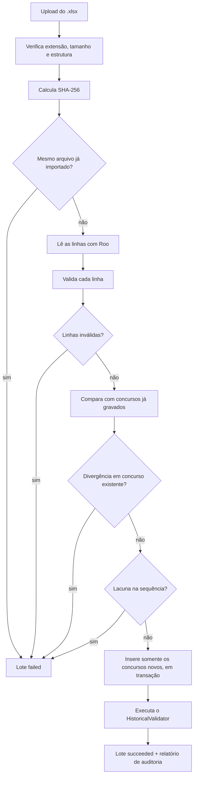

## [← Voltar ao README](../README.md)

---

# Importação e validação do histórico

## Fonte de dados

A fonte prioritária é o histórico oficial de resultados da Mega-Sena disponibilizado pela **Caixa Econômica Federal**, em planilha `.xlsx`.

Princípios:

- priorizar sempre a fonte oficial;
- preservar os dados históricos já importados;
- identificar alterações em concursos existentes;
- evitar duplicidade de registros;
- registrar a origem e o histórico das importações;
- validar os dados antes de disponibilizá-los para análise.

## Regra fundamental

> O MegaStats **não atualiza silenciosamente** um concurso histórico.

Se um concurso já gravado aparece na planilha com informações diferentes, a importação é **rejeitada por inteiro, antes de gravar qualquer registro**. Assim, uma alteração inesperada na fonte nunca modifica o histórico armazenado sem que você perceba.

## Fluxo



Etapas em detalhe:

1. **Recebimento e verificação do arquivo:** extensão `.xlsx`, tamanho máximo de 20 MB, arquivo não vazio.
2. **SHA-256:** se um lote anterior com o mesmo hash foi concluído com sucesso, o envio é rejeitado.
3. **Registro de controle:** um `ImportBatch` é criado no início e atualizado até o fim, inclusive em caso de falha.
4. **Leitura:** a primeira planilha do arquivo é lida; os cabeçalhos são normalizados (sem acentos, minúsculos).
5. **Validação das linhas:** campos obrigatórios, seis dezenas entre 1 e 60 e distintas, data válida, valores não negativos e ausência de concursos duplicados dentro do arquivo.
6. **Comparação com o histórico:** concursos idênticos aos gravados são ignorados; concursos novos são separados para inserção; diferenças são tratadas como divergência.
7. **Sequência:** o conjunto final (existentes + novos) não pode ter lacunas na numeração.
8. **Gravação:** somente concursos novos, dentro de uma transação, junto com a atualização do lote.
9. **Auditoria:** o `HistoricalValidator` roda sobre toda a base e seu relatório é salvo no lote.

## Colunas da planilha

Os cabeçalhos são reconhecidos por nome (sem diferenciar maiúsculas, acentos ou espaços duplicados). Os campos **obrigatórios** são concurso, data e as seis dezenas.

| Cabeçalho aceito                          | Coluna em `draws`          | Obrigatório |
| ----------------------------------------- | -------------------------- | ----------- |
| Concurso                                  | `contest_number`           | Sim         |
| Data do Sorteio                           | `draw_date`                | Sim         |
| Bola1 … Bola6                             | `number_1` … `number_6`    | Sim         |
| Ganhadores 6 acertos                      | `winners_sena`             | Não         |
| Cidade / UF                               | `city_uf`                  | Não         |
| Rateio 6 acertos                          | `prize_sena`               | Não         |
| Ganhadores 5 acertos                      | `winners_quina`            | Não         |
| Rateio 5 acertos                          | `prize_quina`              | Não         |
| Ganhadores 4 acertos                      | `winners_quadra`           | Não         |
| Rateio 4 acertos                          | `prize_quadra`             | Não         |
| Acumulado 6 acertos                       | `accumulated_sena`         | Não         |
| Arrecadação Total                         | `total_revenue`            | Não         |
| Estimativa prêmio                         | `estimated_prize`          | Não         |
| Acumulado Sorteio Especial Mega da Virada | `special_draw_accumulated` | Não         |
| Observação                                | `observation`              | Não         |

Se a Caixa mudar o título de alguma coluna, ajuste a constante `COLUMN_ALIASES` em `app/services/mega_sena/xlsx_importer.rb`.

### Conversão de valores

- **Datas:** células de data do Excel ou texto `dd/mm/aaaa`.
- **Valores monetários:** números do Excel ou texto como `R$ 1.234,56`, convertidos para decimal com 2 casas.
- **Inteiros:** números do Excel ou texto com separador de milhar.
- Células vazias viram `NULL`.

## Lote de importação (`ImportBatch`)

Cada execução gera um registro de auditoria, inclusive as rejeitadas.

| Status       | Descrição                |
| ------------ | ------------------------ |
| `pending`    | Aguardando processamento |
| `processing` | Em execução              |
| `succeeded`  | Concluída                |
| `failed`     | Rejeitada ou com falha   |

Contadores: `total_rows`, `inserted_rows`, `skipped_rows`, `updated_rows` (sempre 0) e `error_rows`.

### `error_details`

Lista JSON. O primeiro item traz a mensagem principal; os demais, os detalhes (limitados a 200).

```json
[
  {
    "message": "Divergência em 1 concurso(s) já importado(s). Nada foi gravado."
  },
  {
    "line": 4,
    "contest_number": 2,
    "fields": {
      "prize_sena": { "existing": "2500000.75", "incoming": "9999999.99" }
    }
  }
]
```

## Validação do histórico

O `MegaSena::HistoricalValidator` audita **toda a base**, não apenas o arquivo recém-importado, e roda automaticamente ao final de cada importação bem-sucedida. Também pode ser executado manualmente (veja [desenvolvimento.md](desenvolvimento.md)).

| Verificação                                                         | Resultado |
| ------------------------------------------------------------------- | --------- |
| Seis dezenas presentes                                              | erro      |
| Dezenas entre 01 e 60                                               | erro      |
| Dezenas repetidas no mesmo concurso                                 | erro      |
| Data ausente ou no futuro                                           | erro      |
| Ordem cronológica (data não pode regredir com o número do concurso) | erro      |
| Valores monetários negativos                                        | erro      |
| Concursos duplicados                                                | erro      |
| Lacunas na sequência de concursos                                   | erro      |
| Histórico que não começa no concurso 1                              | aviso     |

Resultado geral:

| Resultado | Descrição            |
| --------- | -------------------- |
| `passed`  | Nenhum erro ou aviso |
| `warning` | Apenas avisos        |
| `failed`  | Pelo menos um erro   |

Exemplo de `validation_report`:

```json
{
  "result": "passed",
  "checked_draws": 3080,
  "errors_count": 0,
  "warnings_count": 0,
  "errors": [],
  "warnings": [],
  "checked_at": "2026-11-02T14:30:00-03:00"
}
```

Cada problema listado tem `code`, `contest_number` e `message`. São guardados no máximo 100 erros e 100 avisos, mas as contagens (`errors_count`, `warnings_count`) são totais.

## Exemplo de importação incremental

Importando uma planilha atualizada sobre uma base que já tinha 3.077 concursos:

| Indicador                      | Resultado |
| ------------------------------ | --------: |
| Concursos lidos                |     3.080 |
| Concursos existentes ignorados |     3.077 |
| Novos concursos inseridos      |         3 |
| Concursos atualizados          |         0 |
| Erros                          |         0 |
| Resultado da auditoria         |  `passed` |

Após o processamento a base passa a conter 3.080 concursos, numerados de 1 a 3.080.

## Solução de problemas

| Mensagem                                                        | Causa provável                                            | O que fazer                                                                                                |
| --------------------------------------------------------------- | --------------------------------------------------------- | ---------------------------------------------------------------------------------------------------------- |
| Formato inválido: envie um arquivo .xlsx.                       | Arquivo `.xls`, `.csv` ou outro formato                   | Salve/baixe a planilha como `.xlsx`                                                                        |
| Arquivo vazio. / Arquivo maior que 20 MB.                       | Arquivo corrompido ou grande demais                       | Baixe novamente a planilha oficial                                                                         |
| Este arquivo já foi importado com sucesso (importação #N).      | Mesmo arquivo enviado duas vezes                          | Nada a fazer; envie uma planilha mais recente                                                              |
| Colunas obrigatórias ausentes: …                                | Cabeçalhos diferentes do esperado                         | Confira a primeira linha da planilha ou ajuste `COLUMN_ALIASES`                                            |
| A planilha não contém dados.                                    | Planilha sem linhas abaixo do cabeçalho                   | Verifique se os dados estão na primeira aba                                                                |
| Planilha com N problema(s) de validação. Nada foi gravado.      | Linhas com dezenas inválidas, datas ou valores incorretos | Veja `error_details` no lote para localizar a linha                                                        |
| Divergência em N concurso(s) já importado(s). Nada foi gravado. | A fonte alterou dados de um concurso já gravado           | Compare `existing` e `incoming` em `error_details`; decida se a fonte ou a base está correta antes de agir |
| Lacunas na sequência de concursos. Nada foi gravado.            | Planilha com concursos faltando                           | Obtenha a planilha completa                                                                                |
| Erro inesperado: …                                              | Falha não prevista (ex.: banco indisponível)              | Consulte os logs da aplicação                                                                              |

Em qualquer rejeição, **nenhum concurso é gravado**: a base permanece exatamente como estava.

---

## [← Voltar ao README](../README.md)

---
